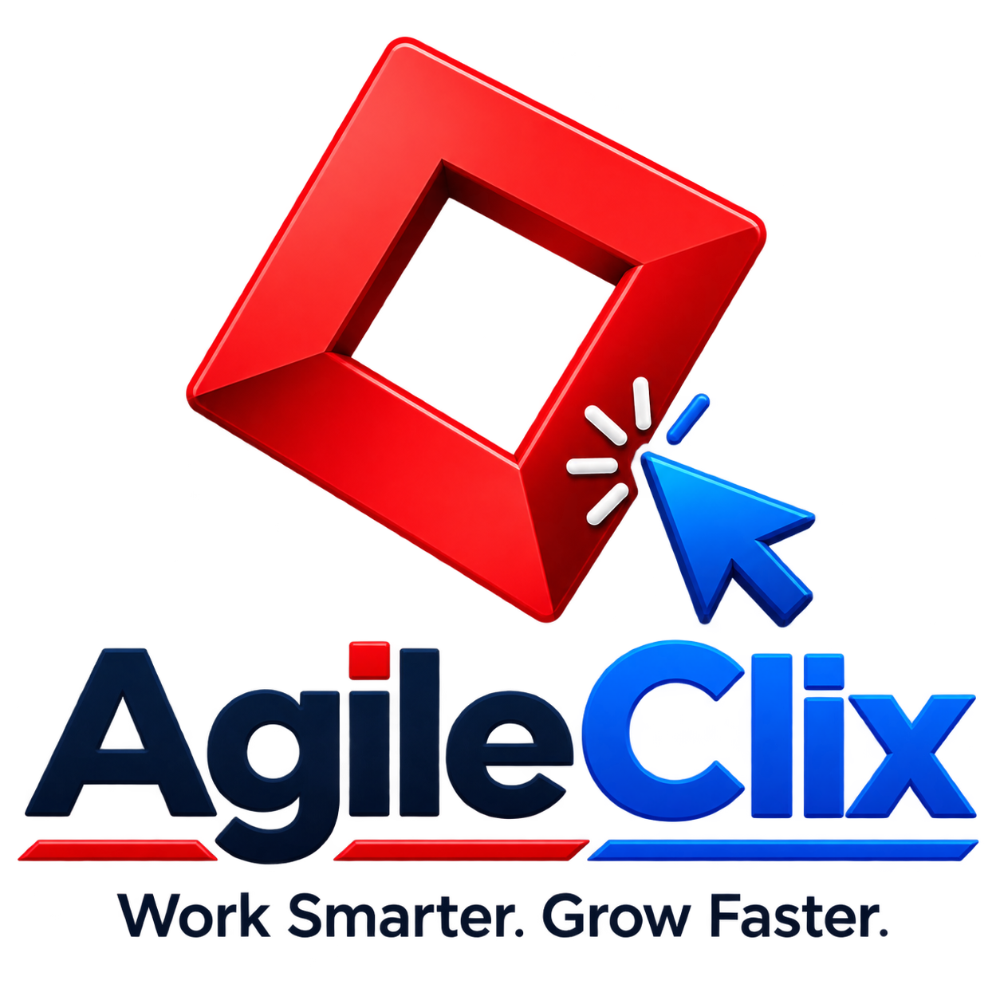

<div align="center">
	
	<h1>AgileClix ERP</h1>
	<p><strong>Work Smarter. Grow Faster.</strong></p>
	<p>One workspace for sales, purchasing, inventory, manufacturing and accounting.</p>
	<p>
		<a href="https://erp.agileclix.com">Live</a>
		·
		<a href="./docs/AGILECLIX_DEV.md">Developer guide</a>
		·
		<a href="#deployment">Deployment</a>
	</p>
</div>

---

## What it is

AgileClix ERP is a complete business management system for growing companies. It covers the full operational cycle, from quotation to cash and from purchase to production, in one branded, permission-controlled workspace.

## Modules

| Module | What it covers |
|---|---|
| **Selling** | Quotations, sales orders, customers, territories, price lists, pricing rules, sales partners |
| **Buying** | Suppliers, requests for quotation, purchase orders, supplier scorecards |
| **Accounts** | Chart of accounts, invoices, payments, bank reconciliation, taxes, financial statements |
| **Stock** | Items, warehouses, stock movements, batches, serial numbers, reorder levels, valuation |
| **Manufacturing** | Bills of materials, work orders, job cards, production planning, subcontracting |
| **Projects** | Projects, tasks, timesheets, project billing |
| **Assets** | Asset register, depreciation, maintenance, movement |
| **Quality** | Quality goals, procedures, inspections, non-conformance |
| **CRM** | Leads, opportunities, campaigns, contracts |
| **Support** | Issues, service level agreements, warranty claims |
| **Portal** | Self-service access for customers and suppliers |
| **Platform** | Users and roles, workflows, printing, email, data import, integrations, automation |

Planned AgileClix products: **Dealer Management (DMS)** and **Vendor Management (VMS)**.

## Highlights

- **White-label branding.** Name, logo, colours, font and wording come from one file, [`brand/brand.json`](brand/brand.json). Run `python brand/apply.py` and every screen follows.
- **Modern UI.** A shadcn-style design layer across the desk, a branded loader, and an app launcher with module cards.
- **Multi-company access control.** Roles decide what a user can do; user permissions limit which company's data they see.
- **Headless web app** (`apps/web`): Next.js, Tailwind CSS, shadcn/ui, zod and Sonner, served through an API gateway (`services/gateway`).
- **One-command deployment** with Docker Compose, ready for Coolify.

## Repository layout

| Path | Purpose |
|---|---|
| `brand/` | Brand source of truth (`brand.json`, logo) and the `apply.py` sync script |
| `frappe_apps/agileclix_erp/` | AgileClix app: branding, desk UI layer, loader, app launcher, gateway APIs |
| `apps/web/` | Next.js headless web app |
| `services/gateway/` | API gateway between the web app and the ERP backend |
| `docker-compose.yml`, `Dockerfile` | Production stack and ERP image |
| `docs/` | Developer guide and architecture notes |

## Deployment

The production stack runs on Docker Compose and is ready for **Coolify**. The step-by-step runbook, covering domains, environment and first deploy, is the header of [`docker-compose.yml`](docker-compose.yml). Backups and redeploy notes are in [`docs/AGILECLIX_DEV.md`](docs/AGILECLIX_DEV.md).

Run locally:

```bash
docker compose up -d --build
# ERP: http://localhost:8080  (sign in as Administrator with SERVICE_PASSWORD_64_ADMIN from .env)
```

Web app in development:

```bash
cd apps/web
npm install
npm run dev   # http://localhost:3000
```

## Rebranding

1. Edit [`brand/brand.json`](brand/brand.json) and replace `brand/logo.png`.
2. Run `python brand/apply.py` (use `--check` in CI).
3. Redeploy.

## License and attribution

AgileClix ERP is built on the open-source [ERPNext](https://github.com/frappe/erpnext) and [Frappe Framework](https://github.com/frappe/frappe) projects and is distributed under the [GNU General Public License v3.0](license.txt). AgileClix is not affiliated with or endorsed by Frappe Technologies Pvt. Ltd.; "ERPNext" and "Frappe" are their trademarks (see [TRADEMARK_POLICY.md](TRADEMARK_POLICY.md)). Upstream credits are listed in [attributions.md](attributions.md).
