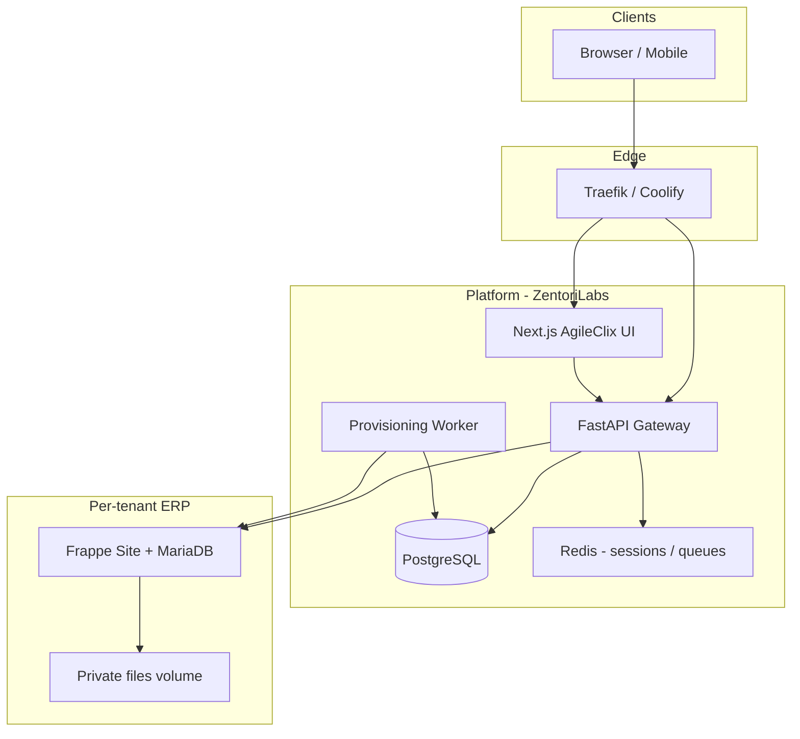

# AgileClix ERP — Target Architecture

**Product:** AgileClix ERP  
**Publisher:** ZentoriLabs  
**Status:** Design target (not yet implemented)

## Vision

Headless, multi-tenant ERP SaaS: **ERPNext/Frappe** remains the business engine and system of record; **FastAPI** is the only public integration surface for the custom UI; **Next.js** delivers a fully branded experience without customer dependency on Frappe Desk.

## Logical layers

## Component responsibilities

### A. AgileClix Frontend (`apps/web/`)

- Next.js App Router, TypeScript, Tailwind, shadcn/ui.
- Routes per master prompt (auth, `/desk`, modules, generic `/records/[doctype]`, platform admin).
- Design tokens: Primary `#2563EB`, Sidebar `#0F172A`, Accent `#0D9488`, etc.
- Talks **only** to FastAPI (except static assets/CDN).
- Authorization reflected in UI; **never** the sole enforcement layer.

### B. AgileClix API Gateway (`services/gateway/`)

- FastAPI + Pydantic v2 models for all external contracts.
- **Tenant resolution:** Host header / verified custom domain → tenant record in PostgreSQL → internal site name (never from client body).
- Auth: HTTP-only session cookies or BFF-issued tokens; CSRF for cookie mutations; rate limits; correlation IDs.
- Frappe integration: service user per tenant or scoped API keys **server-side**; map permissions to Frappe roles; call whitelisted methods and REST with user context.
- Explicit **allowlists** for DocTypes and operations (metadata engine).
- No direct MariaDB access for business data.

### C. ERPNext / Frappe (`agileclix_erp` app + stock ERPNext)

- One **Frappe site** + **MariaDB database** per tenant.
- Custom app `agileclix_erp`: whitelisted APIs, `doc_events`, fixtures, hooks — **no** ERPNext core forks.
- Preserve submit/cancel workflows, GL posting, stock ledger, and validation in Frappe controllers.
- Optional: keep Frappe Desk for break-glass admin (not customer-facing).

### D. Platform data (PostgreSQL)

- Tenants, domains, plans, entitlements, provisioning jobs, audit events, billing references.
- Migrations via Alembic (or SQLModel/SQLAlchemy stack — to be chosen in Phase 1).

### E. Workers

- Idempotent tenant provision: create site, install apps, seed defaults, domain mapping, suspend/restore.
- Backup/restore orchestration per tenant.

## Deployment target (Docker + Coolify + Traefik)

| Service | Image | Notes |
|---------|--------|--------|
| `web` | `agileclix-web` | Next.js standalone |
| `gateway` | `agileclix-gateway` | FastAPI + uvicorn/gunicorn |
| `platform-worker` | `agileclix-platform` | Celery/RQ/Arq TBD |
| `erp-*` | `agileclix-erpnext` | Extend current Frappe Docker pattern |
| `db-platform` | PostgreSQL 16+ | Platform only |
| `db-tenant` | MariaDB 11.8 | Per deployment or shared server with isolated DBs |
| `redis` | Redis 7 | Cache, queue, gateway sessions |

Production compose will **not** rely on `docker-compose.override.yml` (local only).

Traefik routes:

- `*.agileclix.com` or custom domains → resolve tenant → route to gateway + web.
- Internal: gateway → correct Frappe site via `Host` / site map.

## Security baseline

- OWASP ASVS-oriented controls (session fixation, CSRF, SSRF from gateway to Frappe only on allowlist, secrets in env/vault).
- No shared Administrator password across tenants.
- Tenant isolation integration tests mandatory before production.

## Observability

- Structured logs with `X-Correlation-ID`.
- Health: `/health` and `/ready` on gateway and web; Frappe `ping` per site from worker.
- Metrics/alerts: deploy failures, provision queue depth, 5xx rate, Frappe worker backlog.

## Upgrade strategy

- Pin **one** ERPNext/Frappe version line for production images (recommend **v16.50.x** until v17 is validated, or move entire stack to v17 with matching source branch).
- Custom apps (`agileclix_branding` → merged into `agileclix_erp`) versioned with bench migrations.
- Gateway and web semver independently.

## Relation to current repo

Current state is **single-tenant Frappe Docker + desk branding**. Target adds **three new major codebases** (`apps/web`, `services/gateway`, `agileclix_erp`) and **PostgreSQL platform** without removing existing `docker-compose.yml` until cutover compose is validated.
